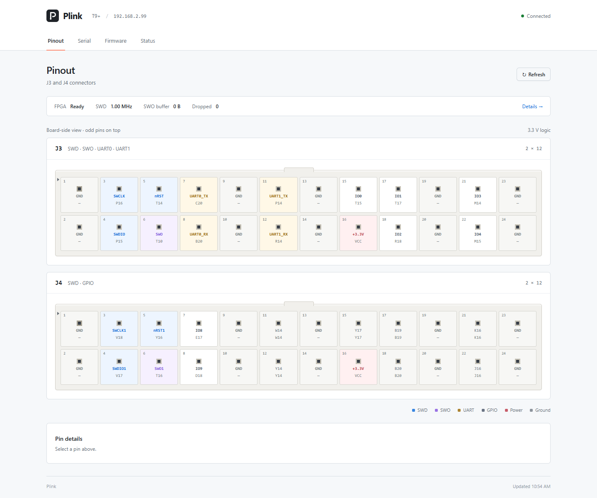

# Plink

**A buffered, measurable FPGA debug probe on the Antminer T9+ / Zynq-7000.**


Plink combines CMSIS-DAP SWD, asynchronous SWO capture and two 115200-baud
serial channels over Ethernet. Windows clients use standard WinUSB and CDC-ACM
interfaces through USB/IP; a dependency-free web workspace provides connector
inspection, serial consoles, programming controls and diagnostics.

## Current status — read before connecting

This branch introduces **hardware/software ABI 2**. It is **not** a drop-in
software update for the older bitstream.

- New transport, buffering, API and RTL changes have offline regression coverage.
- Earlier ABI 1 STM32F407 SWO captures were verified through OpenOCD and Python.
  Those results do not qualify ABI 2.
- **Live ABI 2 qualification is pending.** Sustained trace capture, simultaneous
  dual-CDC traffic, UARTLite IRQ/device-tree behavior and reconnect stability
  still require separately approved hardware tests.
- A Windows `IRQL_NOT_LESS_OR_EQUAL` crash occurred during earlier experiments.
  Its responsible driver and root cause remain unknown. Avoid routine virtual
  hub resets or unattended reconnect experiments.
- No higher-clock or additional-target compatibility claims are made here.

See [HARDENING.md](HARDENING.md), [BUGS.md](BUGS.md) and
[SWO_TESTING.md](SWO_TESTING.md) for implementation and qualification details.

## What changed

| Area | ABI 2 implementation |
|---|---|
| USB/IP | Bounded queues, eight DAP replies, endpoint-specific pending reads, single cancellation completion |
| Serial | 64 KiB receive/transmit rings per channel; retained short reads and partial sends; reconnectable local links |
| Ownership | Shared C/Python advisory leases prevent duplicate pod access and overlapping flash/control operations |
| SWD | Two FPGA engines; bounded completion waits; configurable turnaround/data phase; real pin release |
| SWO | 32 KiB synchronous banked BRAM FIFO, atomic four-byte pop, loss/framing counters, independent 1 MiB software ring |
| AXI-Lite | Independent AW/W acceptance and stable responses under backpressure |
| Web | Horizontal 2×12 pinouts, pin controls, dual serial console, firmware flashing and device status |
| Deployment | Verified matched releases, source/artifact hashes, maintenance locks and fail-closed rollback |

The fabric remains at **100 MHz**. Divider configuration is not a measurement
of external signal integrity or a guarantee of a particular cable/target speed.

## Web interface



After an approved deployment, open `http://192.168.2.99:8080`.

- J3/J4 match the board connector layout: two horizontal rows of 12,
  odd pins above even pins. Select a contact for its pad and controls.
- Serial supports UART0 and UART1, with selectable line endings and text export.
- Controls are always available; there is no API token or unlock step.
- Missing or stale measurements display as a dash, not a fabricated value.
- Programming uploads are binary-safe, limited to 16 MiB and uniquely named.
  The UI asks for confirmation before starting a target write.

The API itself binds to loopback by default; the installed systemd unit enables
LAN access. Use a trusted isolated LAN, firewall, or HTTPS reverse proxy.
Web controls and USB/IP are unauthenticated trusted-network services.
Foreign browser origins are rejected, and hardware ownership checks remain.
Raw UART bridge ports bind to loopback.

For a safe local mock preview, with **no board access**:

```powershell
python tests/preview_ui.py
```

Open the localhost URL it prints. All writes are rejected in this preview.

The current web-only deployment and rollback are recorded in
[`docs/web-ui-20261119.md`](docs/web-ui-20261119.md). It does not replace or
reload the matched FPGA/probe release.

## Wiring

All target signals are **3.3 V logic**, not 5 V tolerant. Share target ground.
The canonical signal mapping is [`hardware/pinmap.json`](hardware/pinmap.json);
unmapped contacts must not be treated as spare GPIO or assumed power pins.

| Header contact | FPGA pad | Signal |
|---|---|---|
| J3.1 / J3.2 | — | Ground reference |
| J3.3 | P16 | SWCLK · pod 1 |
| J3.4 | P15 | SWDIO · pod 1 |
| J3.5 | T14 | nRST, released as open drain |
| **J3.6** | **T10** | **SWO input ← STM32 PB3** |
| J3.7 / J3.8 | C20 / B20 | UART0 TX / RX, from probe perspective |
| J3.11 / J3.12 | P14 / R14 | UART1 TX / RX, from probe perspective |
| J3.15 | T15 | Auxiliary IO0 |
| J4.3 / J4.4 | V18 / V17 | SWCLK / SWDIO · pod 2 |
| J4.5 / J4.6 | Y16 / T16 | nRST / dedicated trace input contact |
| J4.7 / J4.8 | E17 / D18 | Auxiliary IO8 / IO9 |

**Do not drive T10 as BOOT0 while it is connected to PB3.** Default configuration
reserves it for SWO. STM32 UART bootloader handshakes require explicit rewiring
and board-side configuration; the web UI cannot bypass this guard.
The current DAP capture path uses J3 SWO; a J4 trace contact does not imply a
second independently exposed trace stream.

## Build, test and release

Offline checks:

```powershell
python -m unittest discover -s tests -p "test_*.py" -v
python scripts/check_pinmap.py
```

Run `go test ./...` in `plink-tray`. C transport, DAP and SWO ring tests run on
Linux/WSL; RTL simulation and BRAM synthesis use Vivado. See
[HARDENING.md](HARDENING.md) for commands and dependencies.

Build a new matched release with Vivado:

```powershell
vivado -mode batch -source vivado/build_programmer_bitstream.tcl
```

This recreates the generated project, checks the pin map, snapshots source
hashes and packages `.bit`, `.hwh`, PCAP and manifest into `releases/<timestamp>`.
Packaging rejects source changes made during the build.

Verify without deploying:

```powershell
.\deploy_to_board.ps1 -ReleasePath .\releases\<timestamp>
```

**Deployment is a separate live operation**, requiring explicit approval:

```powershell
.\deploy_to_board.ps1 -ReleasePath .\releases\<timestamp> -AllowLiveHardware
```

It stages/builds before stopping clients, installs under `/opt/plink/releases`,
switches `/opt/plink/current`, and loads only a verified release. MMIO clients
require `/run/plink/fpga-ready` containing `plink-abi-2`.
Failure leaves clients stopped rather than reattaching Windows devices.

The repository-root `t9_programmer_pcap.bin` is a **legacy unmatched artifact**,
not a deployment input. Use only generated release directories.

Windows tray source is in `plink-tray/`; both checked-in tray executables are
rebuilt from the hardened source without launching them. Attaching Windows
USB/IP devices is not part of testing, publishing or deployment.
